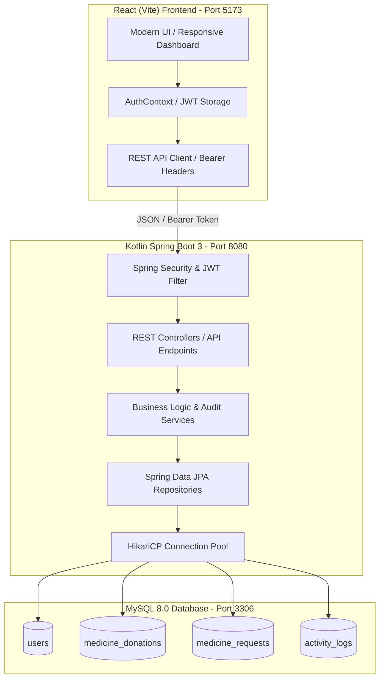

# MediShare - Medicine Donation & Redistribution Platform

[](https://kotlinlang.org/)
[](https://spring.io/projects/spring-boot)
[](https://www.mysql.com/)
[](https://react.dev/)
[](https://github.com/brettwooldridge/HikariCP)

MediShare is a full-stack, enterprise healthcare platform designed to prevent medicine waste by facilitating the safe inspection, verified donation, and equitable redistribution of unexpired medications to patients and charitable clinics.

Every record is stored in **MySQL 8.0** through a **Kotlin Spring Boot** backend. **No hardcoded dashboard metrics or simulated mock data exist** — all statistics are computed dynamically using SQL count and aggregation queries.

---

## 1. System Architecture



---

## 2. Dynamic Dashboards (No Hardcoded Numbers)

### Beneficiary Dashboard
- **Total requests** from database (`SELECT COUNT(*) FROM medicine_requests WHERE beneficiary_id = ?`)
- **Pending requests** from database (`WHERE status = 'PENDING'`)
- **Approved requests** from database (`WHERE status = 'APPROVED'`)
- **Fulfilled requests** from database (`WHERE status = 'FULFILLED'`)

### Donor Dashboard
- **Total donations** from database (`SELECT COUNT(*) FROM medicine_donations WHERE donor_id = ?`)
- **Pending donations** from database (`WHERE status = 'PENDING'`)
- **Approved donations** from database (`WHERE status = 'APPROVED'`)
- **Completed donations** from database (`WHERE status IN ('COMPLETED', 'COLLECTED')`)

### Admin Dashboard
- **Total registered users** (`SELECT COUNT(*) FROM users`)
- **Total donations** (`SELECT COUNT(*) FROM medicine_donations`)
- **Total requests** (`SELECT COUNT(*) FROM medicine_requests`)
- **Verified NGOs** (`SELECT COUNT(*) FROM users WHERE role = 'ROLE_NGO' AND is_verified = TRUE`)
- **Pending approvals** (Pending donations + pending requests + pending NGOs)
- **Expired medicine records** (`SELECT COUNT(*) FROM medicine_donations WHERE expiry_date < CURDATE()`)

---

## 3. Database Configuration

Configured via `application.yml` and `application.properties` with environment variable substitution:

- **Database URL:** `${DB_URL:jdbc:mysql://localhost:3306/medishare_db?useSSL=false&serverTimezone=UTC&allowPublicKeyRetrieval=true}`
- **Database Username:** `${DB_USERNAME:root}`
- **Database Password:** `${DB_PASSWORD:}`
- **MySQL Driver:** `com.mysql.cj.jdbc.Driver`
- **Hibernate Dialect:** `org.hibernate.dialect.MySQLDialect`
- **Hibernate DDL Auto:** `update`
- **Connection Pool:** HikariCP
  - Pool Name: `MediShareHikariPool`
  - Maximum Pool Size: `10`
  - Minimum Idle: `5`
  - Connection Timeout: `20000ms`
  - Idle Timeout: `300000ms`
  - Max Lifetime: `1200000ms`

### Environment Template (`.env.example`)
An `.env.example` file is included in the project root:
```env
SERVER_PORT=8080
DB_URL=jdbc:mysql://localhost:3306/medishare_db?useSSL=false&serverTimezone=UTC&allowPublicKeyRetrieval=true
DB_USERNAME=root
DB_PASSWORD=your_secure_password
JWT_SECRET=404E635266556A586E3272357538782F413F4428472B4B6250645367566B5970
JWT_EXPIRATION_MS=86400000
VITE_API_BASE_URL=http://localhost:8080/api
```

> **Security Note:** Database credentials and secrets are managed via environment variables and never exposed to frontend bundles or GitHub.

---

## 4. Pre-seeded Demo Accounts

| Role | Email | Password | Status |
|---|---|---|---|
| **System Administrator** | `admin@medishare.org` | `admin123` | Full Access |
| **Verified Medicine Donor** | `donor@medishare.org` | `donor123` | Verified |
| **Patient / Beneficiary** | `beneficiary@medishare.org` | `user123` | Verified |
| **Partner Healthcare NGO** | `ngo@carehope.org` | `ngo123` | Verified NGO |
| **Clinic Awaiting Approval** | `pending@sunriseclinic.org` | `ngo123` | Pending NGO |

---

## 5. Automated 13-Point Database Verification Test

All 13 acceptance points are automated and covered in:
[`backend/src/test/kotlin/com/medishare/MediShareDatabaseIntegrationTests.kt`](file:///backend/src/test/kotlin/com/medishare/MediShareDatabaseIntegrationTests.kt)

```
✓ Point 1: Register a new user via API
✓ Point 2: Check user appears in MySQL `users` table
✓ Point 3: Log in with that user and obtain JWT
✓ Point 4: Submit a new medicine donation
✓ Point 5: Check donation appears in MySQL `medicine_donations` table
✓ Point 6: Refresh website / fetch user donations
✓ Point 7: Confirm donation is still displayed
✓ Point 8: Submit a medicine request
✓ Point 9: Check `medicine_requests` table in MySQL
✓ Point 10: Approve donation as authorized admin
✓ Point 11: Verify database status changes to APPROVED in MySQL
✓ Point 12: Log out and log in again
✓ Point 13: Confirm saved information is still available across sessions
```

Run the verification test suite at any time:
```powershell
.\scripts\verify-flow.ps1
```
or in backend:
```bash
./gradlew test
```

---

## 6. How to Run the Project

### Prerequisites
- Java 21+
- Node.js 18+ and npm
- MySQL 8.0+ running on port 3306

### Step 1: Start MySQL and Initialize Database
```powershell
# Using the PowerShell helper script
.\scripts\init-database.ps1

# Or with Docker:
cd database
docker-compose up -d
```

### Step 2: Start the Kotlin Spring Boot Backend
```powershell
.\scripts\run-backend.ps1
# Backend runs on http://localhost:8085
```

### Step 3: Start the React Frontend
```powershell
.\scripts\run-frontend.ps1
# Frontend runs on http://localhost:5173
```

---

## 7. REST API Endpoints Reference

| Method | Endpoint | Access | Purpose |
|---|---|---|---|
| `POST` | `/api/auth/register` | Public | Register new user (Donor, Beneficiary, NGO) |
| `POST` | `/api/auth/login` | Public | Authenticate and retrieve JWT token |
| `GET` | `/api/auth/me` | Authenticated | Get current user profile |
| `POST` | `/api/donations` | Donor, Admin | Submit new medicine donation into MySQL |
| `GET` | `/api/donations/my` | Donor | Get all donations for logged-in donor |
| `GET` | `/api/donations/available` | Public | List approved, unexpired medications |
| `PATCH` | `/api/donations/{id}/status` | Admin | Approve or reject medicine donation |
| `POST` | `/api/requests` | Beneficiary, NGO | Submit prescription request into MySQL |
| `GET` | `/api/requests/my` | Beneficiary, NGO | Get requests submitted by current user |
| `PATCH` | `/api/requests/{id}/status` | Admin | Approve or fulfill medication request |
| `GET` | `/api/dashboard/donor` | Donor, Admin | Get dynamic MySQL counts for donor |
| `GET` | `/api/dashboard/beneficiary` | Beneficiary, Admin | Get dynamic MySQL counts for beneficiary |
| `GET` | `/api/dashboard/admin` | Admin | Get dynamic MySQL counts for administrator |
| `GET` | `/api/admin/expired-medicines` | Admin | Query quarantined expired medications |
| `PATCH` | `/api/admin/users/{id}/verify` | Admin | Toggle NGO verification status |
| `GET` | `/api/health` | Public | Real-time database and service health check |

---

## 8. Database Schema Overview

```sql
users (
    id BIGINT AUTO_INCREMENT PRIMARY KEY,
    full_name VARCHAR(100) NOT NULL,
    email VARCHAR(100) NOT NULL UNIQUE,
    password VARCHAR(255) NOT NULL,
    role VARCHAR(30) NOT NULL,
    phone VARCHAR(20),
    address VARCHAR(255),
    organization_name VARCHAR(150),
    is_verified BOOLEAN NOT NULL DEFAULT FALSE,
    created_at TIMESTAMP DEFAULT CURRENT_TIMESTAMP
);

medicine_donations (
    id BIGINT AUTO_INCREMENT PRIMARY KEY,
    donor_id BIGINT NOT NULL,
    medicine_name VARCHAR(150) NOT NULL,
    generic_name VARCHAR(150),
    category VARCHAR(100),
    quantity INT NOT NULL,
    unit VARCHAR(30) NOT NULL DEFAULT 'tablets',
    expiry_date DATE NOT NULL,
    batch_number VARCHAR(50),
    manufacturer VARCHAR(100),
    storage_condition VARCHAR(100),
    condition_notes TEXT,
    status VARCHAR(30) NOT NULL DEFAULT 'PENDING',
    pickup_address VARCHAR(255),
    image_proof_url VARCHAR(500),
    created_at TIMESTAMP DEFAULT CURRENT_TIMESTAMP,
    updated_at TIMESTAMP DEFAULT CURRENT_TIMESTAMP ON UPDATE CURRENT_TIMESTAMP,
    FOREIGN KEY (donor_id) REFERENCES users(id) ON DELETE CASCADE
);

medicine_requests (
    id BIGINT AUTO_INCREMENT PRIMARY KEY,
    beneficiary_id BIGINT NOT NULL,
    medicine_name VARCHAR(150) NOT NULL,
    quantity_requested INT NOT NULL,
    urgency_level VARCHAR(20) NOT NULL DEFAULT 'MEDIUM',
    prescription_proof_url VARCHAR(500),
    reason TEXT,
    status VARCHAR(30) NOT NULL DEFAULT 'PENDING',
    matched_donation_id BIGINT NULL,
    admin_notes TEXT,
    created_at TIMESTAMP DEFAULT CURRENT_TIMESTAMP,
    updated_at TIMESTAMP DEFAULT CURRENT_TIMESTAMP ON UPDATE CURRENT_TIMESTAMP,
    FOREIGN KEY (beneficiary_id) REFERENCES users(id) ON DELETE CASCADE,
    FOREIGN KEY (matched_donation_id) REFERENCES medicine_donations(id) ON DELETE SET NULL
);
```
